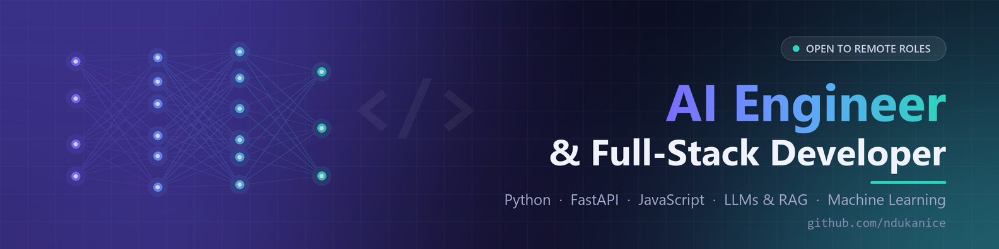

# Hi, I'm Emmanuel 👋

I'm an **AI Engineer and Full-Stack Developer** based in Lagos, Nigeria. I build practical AI and data tools, from LLM apps with retrieval-augmented generation to machine-learning dashboards, and ship them as working web apps.

- 🎓 Studying **Software Development** at Brigham Young University-Idaho and trained in AI and data science at **Pioneer Artificial Intelligence Academy**
- 💼 5+ years in customer support, sales and business development before moving into tech, so I build with the end user in mind
- 🌍 **Open to remote** AI Engineer, Machine Learning Engineer and Data Scientist roles

## 🚀 Featured projects

| Project | What it does | Stack | Links |
| --- | --- | --- | --- |
| **Multi-Model Chatbot** | Sends one prompt to NVIDIA, Claude and OpenRouter models in parallel and compares their answers side by side | Python, FastAPI, JavaScript, Vercel | [Live](https://multimodelschatbot.vercel.app/) · [Code](https://github.com/ndukanice/Multi-model-chatbot) |
| **TriageGuard** | AI clinical triage copilot: turns patient intake into urgency recommendations grounded in clinical protocols (RAG) | TypeScript, React, Express, LLMs | [Live](https://triageguard.onrender.com/) · [Code](https://github.com/ndukanice/TRIAGEGUARD) |
| **Customer Churn & CLV Dashboard** | Predicts customer churn risk and lifetime value with three trained models | Python, scikit-learn, XGBoost, Streamlit | [Live](https://my-2nddatascienceproject-oct-2025-kqbmrnh9xezdotsngd3hpz.streamlit.app/) · [Code](https://github.com/ndukanice/My-_2nd_Data_Science_Project-Oct-2025) |
| **US Weather + Energy Dashboard** | Data pipeline combining NOAA weather and EIA energy data, with an interactive analysis dashboard | Python, pandas, Plotly, Streamlit | [Live](https://mydata-scienceproject-julu-2025git-nzzw8j8znxvtkrmdzlqsia.streamlit.app/) · [Code](https://github.com/ndukanice/My_Data-_Science_Project-Julu-2025) |
| **Feast Together** | Plans meals for group gatherings around everyone's dietary needs, with recipe search and shopping lists | JavaScript, HTML, CSS, Spoonacular API | [Live](https://ndukanice.github.io/WDD330-Feast-Together/) · [Code](https://github.com/ndukanice/WDD330-Feast-Together) |

## 🛠️ Tech stack

**Languages:** Python · JavaScript · TypeScript · SQL · C#  
**AI & data:** LLM APIs · RAG · scikit-learn · XGBoost · pandas · Plotly · Streamlit  
**Web:** FastAPI · Flask · Node.js · Express · React · MongoDB · REST APIs  
**Tools:** Git · GitHub · Vercel · Render · AWS fundamentals

## 📜 Certifications

IBM Data Science Professional · DeepLearning.AI Retrieval Augmented Generation · DataCamp Associate AI Engineer for Developers · Google IT Automation with Python

## 📫 Connect

[LinkedIn](https://www.linkedin.com/in/emmanuel-nduka-2583b3236/)
